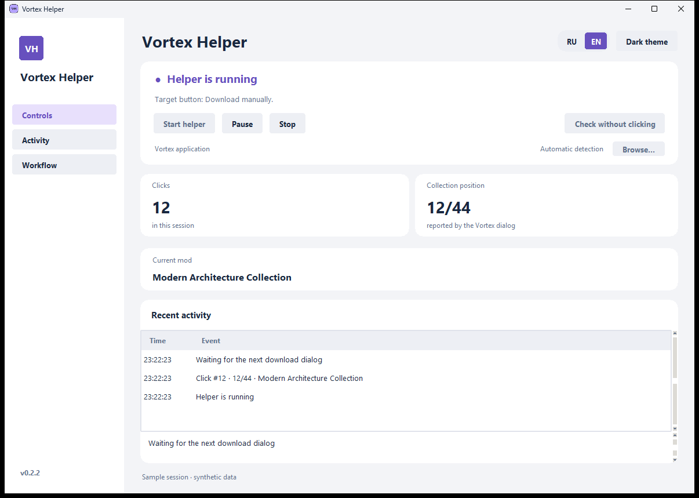

# Vortex Helper

[Русский](README.ru.md) · [Home](README.md) · Windows 10/11 x64 · [Portfolio case study](https://qlage.github.io/case-vortex-helper.html)

## Download and run

**[Download VortexDownloadHelper.exe](https://github.com/qLage/vortex-download-helper/releases/latest/download/VortexDownloadHelper.exe)**

[Release page](https://github.com/qLage/vortex-download-helper/releases/latest) · [SHA256SUMS.txt](https://github.com/qLage/vortex-download-helper/releases/latest/download/SHA256SUMS.txt)

A portable `.exe`, with no installer or separate Python requirement. Language, theme and Vortex-path preferences live in `VortexDownloadHelper-data` beside the executable. The bundled Python/Tk runtime and control-channel files temporarily use TEMP and are removed on normal exit. No service, autostart entry, shortcut or installed-app registration is created.



## Usage

The Workflow section shows Vortex → dialog check → click and includes the check-without-clicking action.

1. Open Vortex and start a collection download.
2. Optionally select `Vortex.exe`; otherwise the single running Vortex window is detected.
3. Check without clicking reads the dialog without invoking it.
4. Once the helper recognizes the current mod dialog, select **Start**. Pause, resume and stop are available in the same window.

F8 stops; F9 toggles pause. Closing the window stops only the owned helper process, leaving Vortex running. Switching language also translates the activity log. Dark and light themes are available. The interface shows the current mod, collection position, click count and the latest 200 events.

[Workflow screenshot](docs/screenshots/workflow.png)

## Button selection

Windows UI Automation resolves the intended process window → `free-user-dl-dialog` → `download-mod-button`. The enabled button, mod title and single `current/total` counter must be present. Two stable observations are followed by another fresh read immediately before invocation. Mod title, counter and process start time form the identity. Moving the button does not trigger another click.

Each identity is invoked at most once per helper run. Uncertain results are not automatically retried. A named mutex prevents duplicate helpers. Stop control is checked again immediately before invocation. Polling defaults to 750 ms and runs only after the helper is started. A 20-minute idle timeout stops it; this does not establish that every file downloaded.

## Limits

Verified Vortex 2.6.2 controls have English labels. The helper language does not change Vortex. Browser pages, CAPTCHA, login, external-link confirmation and installation errors may require your attention. Premium, Skip and Cancel are not invoked. Download speed limits are not bypassed. Mod files and account settings are not changed.

For a stuck `Installing…`, inspect the Vortex log: downloading and installing are different stages. This helper does not move game data or repair incompatible mods. Run Vortex and the helper at the same privilege level.

## Source and console

The source GUI requires Python 3.10+ with Tkinter. The engine uses Windows PowerShell 5.1.

```powershell
git clone https://github.com/qLage/vortex-download-helper.git
cd vortex-download-helper
python gui.py
powershell.exe -NoProfile -STA -ExecutionPolicy Bypass -File .\Vortex-download-helper.ps1 -CheckOnly -Language en
powershell.exe -NoProfile -File .\tests\Test-Helper.ps1
python -m unittest discover -s tests -v
python gui.py --self-test --artifacts gui-artifacts
```

`Start-GUI.cmd` opens the interface. `Start-Vortex-helper.cmd` retains console usage with `-Language ru/en`, `-VortexPath`, `-IdleMinutes` and `-PollMilliseconds`. The execution-policy bypass is process-scoped. Console mode writes `%TEMP%/Vortex-download-helper.log`; GUI mode keeps its activity log in memory and does not create that persistent file.

## Build the portable EXE

```powershell
python -m venv .build-env
.\.build-env\Scripts\python.exe -m pip install -r build-requirements.txt
.\.build-env\Scripts\python.exe build_windows.py --output dist --work build
.\.build-env\Scripts\python.exe verify_windows_package.py --directory dist
```

Outputs are `dist/VortexDownloadHelper.exe` and `SHA256SUMS.txt`. No installer is created.

[Verification, including real UI Automation against an isolated fixture window](VERIFICATION.md) · MIT · [SECURITY.md](SECURITY.md). Independent project, not affiliated with Nexus Mods. No mods or third-party game files are bundled.
