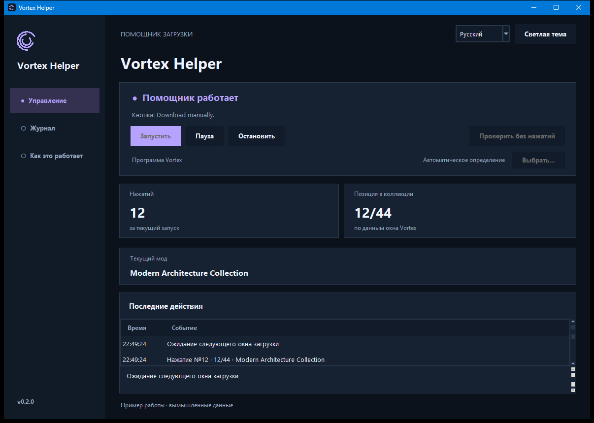
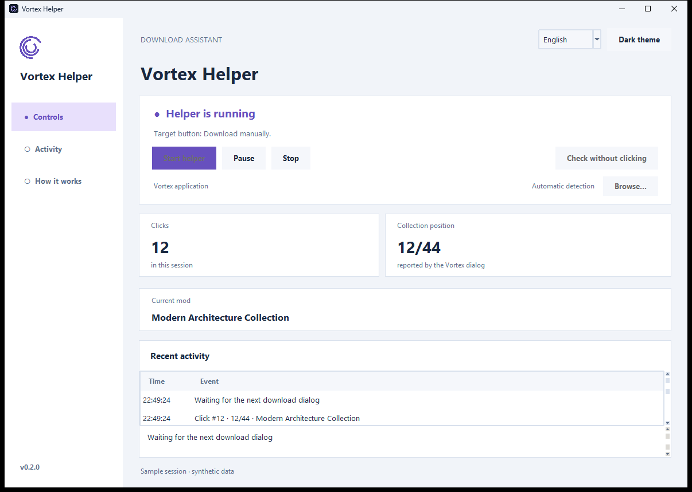

# Vortex Helper

[Русский](#русский) · [English](#english) · [Releases](https://github.com/qLage/vortex-download-helper/releases)

## Русский

[English](README.en.md) · [Главная](README.md) · Windows 10/11 x64

## Скачать и запустить

**[Скачать VortexDownloadHelper.exe](https://github.com/qLage/vortex-download-helper/releases/latest/download/VortexDownloadHelper.exe)**

Portable-версия: один `.exe`, без установки и отдельного Python. Настройки языка, темы и пути Vortex хранятся в `VortexDownloadHelper-data` рядом с программой. Временные файлы встроенного Python/Tk и канала управления создаются в TEMP и очищаются при штатном завершении. Программа не регистрирует службу, автозапуск, ярлыки или записи установленных приложений.



## Использование

1. Откройте Vortex и начните загрузку коллекции.
2. При необходимости выберите `Vortex.exe`; по умолчанию используется единственное открытое окно Vortex.
3. Кнопка «Проверить без нажатий» читает окно, ничего не нажимая.
4. Нажмите «Запустить». Пауза, продолжение и остановка доступны в этом же окне.

F8 останавливает помощник, F9 переключает паузу. Закрытие окна завершает созданный помощником процесс, сохраняя Vortex работающим. При смене языка журнал переводится; доступна тёмная и светлая тема. В интерфейсе отображаются текущий мод, позиция коллекции, число нажатий и журнал последних 200 событий.

## Как выбирается кнопка

Используется Windows UI Automation: окно нужного процесса → `free-user-dl-dialog` → `download-mod-button`. Проверяются активность кнопки, название мода и единственный счётчик `текущий/всего`. После двух стабильных наблюдений окно читается снова непосредственно перед вызовом кнопки. Название мода, счётчик и время запуска процесса образуют идентификатор. Перемещение кнопки повторного нажатия не вызывает.

Одна комбинация нажимается не более одного раза за запуск помощника. От неопределённого результата нет автоматического повтора. Именованный mutex исключает два экземпляра. Проверка команды остановки выполняется также непосредственно перед нажатием. По умолчанию опрос идёт раз в 750 мс только при запущенном помощнике. После 20 минут без нового нажатия он останавливается; это не подтверждение завершения загрузки.

## Ограничения

Проверенные элементы Vortex 2.6.2 имеют английские названия. Язык помощника не изменяет язык Vortex. Страницы браузера, CAPTCHA, вход, подтверждение внешних ссылок и ошибки установки модов могут потребовать действий пользователя. Premium, Skip и Cancel не нажимаются. Ограничения скорости не обходятся. Файлы модов и учётная запись не изменяются.

При зависшем `Installing…` проверьте журнал Vortex: загрузка и установка — разные этапы. Этот помощник не переносит игровые данные и не исправляет несовместимые моды. Выполняйте Vortex и помощник с одинаковыми правами.

## Исходники и консоль

Для GUI из исходников нужен Python 3.10+ с Tkinter. Движок требует Windows PowerShell 5.1.

```powershell
python gui.py
powershell.exe -NoProfile -STA -ExecutionPolicy Bypass -File .\Vortex-download-helper.ps1 -CheckOnly -Language ru
powershell.exe -NoProfile -File .\tests\Test-Helper.ps1
python -m unittest discover -s tests -v
python gui.py --self-test --artifacts gui-artifacts
```

`Start-GUI.cmd` открывает интерфейс. `Start-Vortex-helper.cmd` сохраняет консольный вариант с параметрами `-Language ru/en`, `-VortexPath`, `-IdleMinutes`, `-PollMilliseconds`. Обход политики выполнения применяется только к процессу PowerShell. Консольный режим сохраняет журнал в `%TEMP%/Vortex-download-helper.log`; GUI сохраняет журнал в памяти и не создаёт этот постоянный файл.

## Сборка portable EXE

```powershell
python -m venv .build-env
.\.build-env\Scripts\python.exe -m pip install -r build-requirements.txt
.\.build-env\Scripts\python.exe build_windows.py --output dist --work build
```

Результат: `dist/VortexDownloadHelper.exe` и `SHA256SUMS.txt`. Установщик не создаётся.

[Проверки, включая тест настоящего UI Automation на отдельном тестовом окне](VERIFICATION.md) · MIT · [SECURITY.md](SECURITY.md). Независимый проект, не связан с Nexus Mods. Моды и сторонние игровые файлы не включены.

---

## English

[Русский](README.ru.md) · [Home](README.md) · Windows 10/11 x64

## Download and run

**[Download VortexDownloadHelper.exe](https://github.com/qLage/vortex-download-helper/releases/latest/download/VortexDownloadHelper.exe)**

A portable `.exe`, with no installer or separate Python requirement. Language, theme and Vortex-path preferences live in `VortexDownloadHelper-data` beside the executable. The bundled Python/Tk runtime and control-channel files temporarily use TEMP and are removed on normal exit. No service, autostart entry, shortcut or installed-app registration is created.



## Usage

1. Open Vortex and start a collection download.
2. Optionally select `Vortex.exe`; otherwise the single running Vortex window is detected.
3. Check without clicking reads the dialog without invoking it.
4. Start the helper. Pause, resume and stop are available in the same window.

F8 stops; F9 toggles pause. Closing the window stops only the owned helper process, leaving Vortex running. Switching language also translates the activity log. Dark and light themes are available. The interface shows the current mod, collection position, click count and the latest 200 events.

## Button selection

Windows UI Automation resolves the intended process window → `free-user-dl-dialog` → `download-mod-button`. The enabled button, mod title and single `current/total` counter must be present. Two stable observations are followed by another fresh read immediately before invocation. Mod title, counter and process start time form the identity. Moving the button does not trigger another click.

Each identity is invoked at most once per helper run. Uncertain results are not automatically retried. A named mutex prevents duplicate helpers. Stop control is checked again immediately before invocation. Polling defaults to 750 ms and runs only after the helper is started. A 20-minute idle timeout stops it; this does not establish that every file downloaded.

## Limits

Verified Vortex 2.6.2 controls have English labels. The helper language does not change Vortex. Browser pages, CAPTCHA, login, external-link confirmation and installation errors may require your attention. Premium, Skip and Cancel are not invoked. Download speed limits are not bypassed. Mod files and account settings are not changed.

For a stuck `Installing…`, inspect the Vortex log: downloading and installing are different stages. This helper does not move game data or repair incompatible mods. Run Vortex and the helper at the same privilege level.

## Source and console

The source GUI requires Python 3.10+ with Tkinter. The engine uses Windows PowerShell 5.1.

```powershell
python gui.py
powershell.exe -NoProfile -STA -ExecutionPolicy Bypass -File .\Vortex-download-helper.ps1 -CheckOnly -Language en
powershell.exe -NoProfile -File .\tests\Test-Helper.ps1
python -m unittest discover -s tests -v
python gui.py --self-test --artifacts gui-artifacts
```

`Start-GUI.cmd` opens the interface. `Start-Vortex-helper.cmd` retains console usage with `-Language ru/en`, `-VortexPath`, `-IdleMinutes` and `-PollMilliseconds`. The execution-policy bypass is process-scoped. Console mode writes `%TEMP%/Vortex-download-helper.log`; GUI mode keeps its activity log in memory and does not create that persistent file.

## Build the portable EXE

```powershell
python -m venv .build-env
.\.build-env\Scripts\python.exe -m pip install -r build-requirements.txt
.\.build-env\Scripts\python.exe build_windows.py --output dist --work build
```

Outputs are `dist/VortexDownloadHelper.exe` and `SHA256SUMS.txt`. No installer is created.

[Verification, including real UI Automation against an isolated fixture window](VERIFICATION.md) · MIT · [SECURITY.md](SECURITY.md). Independent project, not affiliated with Nexus Mods. No mods or third-party game files are bundled.
